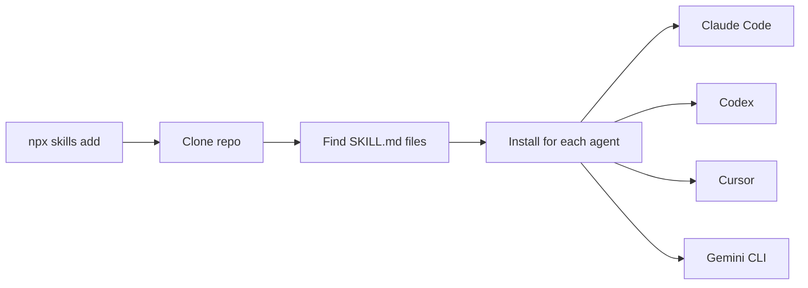

<div align="center">


<br><br>


<a href="https://github.com/koravut-Dev/Publish_Skill/tags"></a>
<a href="https://github.com/koravut-Dev/Publish_Skill/actions"></a>
<a href="https://github.com/koravut-Dev/Publish_Skill"></a>

<br>

[English](README.md) &nbsp;·&nbsp; **ไทย**

**[สกิล](#skills)** &nbsp;·&nbsp; **[ติดตั้ง](#install)** &nbsp;·&nbsp; **[ทำงานอย่างไร](#how-it-works)** &nbsp;·&nbsp; **[โครงสร้าง](#repo-layout)** &nbsp;·&nbsp; **[ร่วมพัฒนา](#contributing)**

<br>

```bash
npx skills add koravut-Dev/Publish_Skill
```

</div>

<!-- skills:start -->
<!-- skills:lang=th -->
<a id="skills"></a>

## สกิล

<table>
<tr>
<td colspan="2" valign="top">

#### publish-skill

นำสกิลที่สร้างไว้ (โฟลเดอร์ที่มี SKILL.md) เข้า git repo ตามมาตรฐาน Agent Skills เพื่อให้คนอื่นติดตั้งได้ด้วยคำสั่งเดียว เช่น `npx skills add owner/repo` รวมถึงตรวจสกิลก่อนเผยแพ...

<sub>ลองพิมพ์: <code>publish skill</code> · <code>เอาสกิลขึ้น repo</code> · <code>ทำให้ติดตั้งได้ด้วย command</code> · <code>แจกสกิล</code></sub>

```bash
npx skills add koravut-Dev/Publish_Skill --skill publish-skill
```

</td>
</tr>
</table>

<a id="install"></a>

## ติดตั้ง

> [!TIP]
> คำสั่งเดียวติดตั้งทุกสกิลใน repo นี้ให้ทุก agent ที่ตรวจพบในเครื่อง

```bash
# ทุกสกิลใน repo นี้
npx skills add koravut-Dev/Publish_Skill

# เฉพาะสกิลเดียว
npx skills add koravut-Dev/Publish_Skill --skill publish-skill
```

<details>
<summary><b>Claude Code plugin marketplace</b></summary>

```text
/plugin marketplace add koravut-Dev/Publish_Skill
```

</details>

<details>
<summary><b>ดาวน์โหลดเป็น zip</b></summary>

ทุก [release](https://github.com/koravut-Dev/Publish_Skill/releases) แนบไฟล์ zip แยกตามสกิล แตกไฟล์ลงในโฟลเดอร์ skills ของ agent ที่ใช้

</details>

<details>
<summary><b>คัดลอกเอง</b></summary>

```bash
git clone https://github.com/koravut-Dev/Publish_Skill.git
cp -r Publish_Skill/skills/publish-skill ~/.claude/skills/
```

```powershell
Copy-Item -Recurse Publish_Skill\skills\publish-skill "$HOME\.claude\skills\"
```

| Agent | ส่วนตัว | ในโปรเจกต์ |
|---|---|---|
| Claude Code | `~/.claude/skills/` | `.claude/skills/` |
| Codex CLI | `~/.codex/skills/` | `.agents/skills/` |
| Cursor | `~/.cursor/skills/` | `.cursor/skills/` |
| Gemini CLI | `~/.gemini/skills/` | `.gemini/skills/` |
| GitHub Copilot | `~/.copilot/skills/` | `.github/skills/` |
| OpenCode | `~/.config/opencode/skills/` | `.opencode/skills/` |
| อื่นๆ | ดูเอกสารของเครื่องมือ | ดูเอกสารของเครื่องมือ |

</details>

> [!IMPORTANT]
> สกิลทำงานด้วยสิทธิ์เต็มของ agent อ่านสกิลก่อนติดตั้งทุกครั้ง ตำแหน่งโฟลเดอร์และ flag ของ CLI เปลี่ยนได้ตามเวลา ให้ตรวจกับเอกสารล่าสุดของแต่ละเครื่องมือ

<a id="how-it-works"></a>

## ทำงานอย่างไร



<a id="repo-layout"></a>

## โครงสร้าง repo

```text
Publish_Skill/
├── README.md
├── README.th.md
├── CHANGELOG.md
├── AGENTS.md
├── LICENSE
├── assets/
│   └── banner.svg
├── .claude-plugin/
│   ├── plugin.json
│   └── marketplace.json
├── .github/
│   └── workflows/
└── skills/
    └── publish-skill/SKILL.md
```

ชื่อโฟลเดอร์ของแต่ละสกิลต้องตรงกับ `name` ใน frontmatter ของ `SKILL.md` ตามมาตรฐาน Agent Skills

<a id="contributing"></a>

## ร่วมพัฒนา

1. เพิ่มหรือแก้สกิลใต้ `skills/<name>/SKILL.md`
2. ต้องมี `name` (ตัวพิมพ์เล็กคั่นด้วยขีด และตรงกับชื่อโฟลเดอร์) กับ `description` ใน frontmatter
3. ห้าม commit secret สคริปต์ publish จะสแกนหาให้
4. เปิด pull request
<!-- skills:end -->

<div align="center">

<sub>สร้างด้วยสกิล <code>publish-skill</code> &nbsp;·&nbsp; <a href="#">กลับขึ้นบน ↑</a></sub>

</div>
